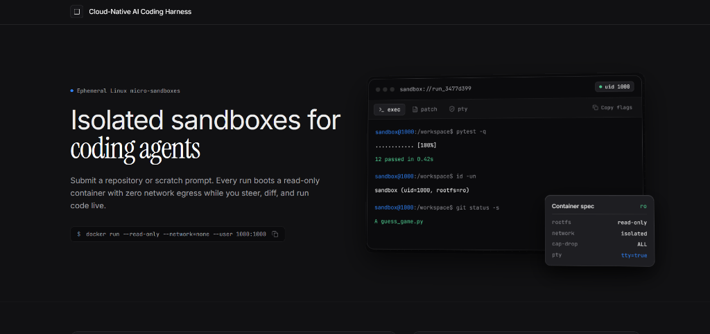
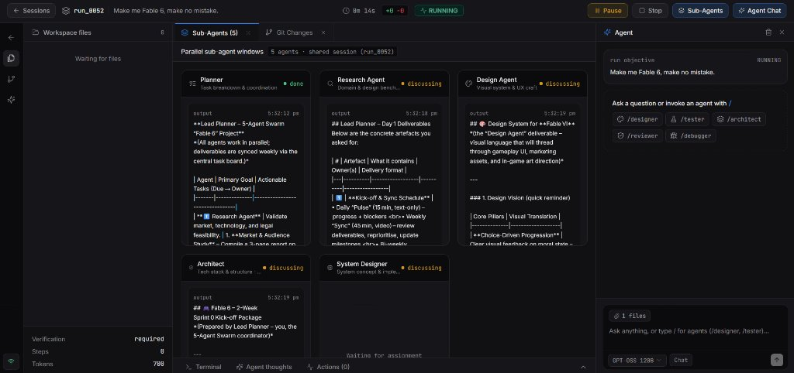
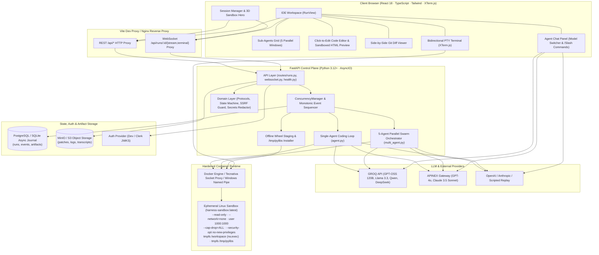

# Cloud-Native AI Coding Harness

An autonomous, full-stack AI engineering workbench that runs coding agents and parallel multi-agent swarms inside kernel-isolated, ephemeral Docker micro-sandboxes—paired with an in-browser IDE, live HTML preview, bidirectional PTY shell, side-by-side Git diff inspector, and an Antigravity-style AI agent chat.

---

## Visual Tour

### 1. Landing Workbench & 3D Micro-Sandbox Visualizer
Asymmetric split hero built on a Graphite dark ramp with an interactive 3D container inspector (`exec`, `patch`, and `pty` views), kernel spec readout, single- or multi-agent run configurator, execution workflow diagram, and persistent session history.



### 2. Parallel 5-Agent Swarm IDE & Antigravity-Style Agent Chat
Complex tasks launch 5 specialized agents concurrently inside one shared session (`Planner`, `Research Agent`, `Design Agent`, `Architect`, and `System Designer`) with peer-to-peer discussion, shared context synchronization, workspace explorer, interactive PTY terminal, and a right-hand AI chat panel with model selection and `/` slash commands.



---

## Comprehensive System Architecture



### Clean Architecture & Dependency Rule
All backend dependencies point strictly inward:

`api/` → `application/` → `domain/` ← `infrastructure/`

- **`backend/app/domain/`**: Framework-agnostic `@runtime_checkable` `Protocol` interfaces (`ISandboxProvider`, `ISandboxEnvironment`, `ILLMProvider`, `IRunRepository`, `IObjectStorage`, `IAuthProvider`), Pydantic v2 schemas, run lifecycle state machine, and SSRF / secret redaction guards.
- **`backend/app/application/`**:
  - `agent.py`: Autonomous tool-calling execution loop with fresh verification gates and step-boundary pause/resume control.
  - `multi_agent.py`: **5-Agent Parallel Swarm Orchestrator** executing `asyncio.gather` parallel research/design/architecture phases, cross-agent peer discussions, and a shared session context board (`=== SHARED SESSION CONTEXT ===`) inside one unified `run_id`.
  - `concurrency.py`: Monotonic gap-free event sequence assignment (`seq = 1, 2, 3...`), WebSocket fan-out, and per-run locking.
  - `diff.py`: Git diff calculation against the run's baseline commit SHA.
- **`backend/app/infrastructure/`**: Concrete adapters for Docker sandboxes (`DockerSandboxProvider`), async SQLAlchemy 2 (`PostgresRunRepository` supporting PostgreSQL & SQLite), `OpenAIProvider` / `AnthropicProvider`, S3/MinIO (`S3ObjectStorage`), and `ClerkAuthProvider` / `DevAuthProvider`.

---

## Key Features

### Parallel 5-Agent Swarm (Shared Session & Context)
When **Multi-agent swarm (5 parallel)** is enabled, one shared session spawns 5 dedicated agent windows that collaborate over a synchronized context board:

| Agent | Responsibility | Cross-Agent Collaboration |
|---|---|---|
| **Planner** | Breaks the prompt into concrete assignments for the swarm | Broadcasts task plan to all agents |
| **Research Agent** | Analyzes real-world benchmarks, UX flows, and domain content | Shares findings; replies to **System Designer** |
| **Design Agent** | Defines palette, typography scale, spacing, and UI components | Syncs visual tokens with **Architect** |
| **Architect** | Chooses tech stack, file layout, and state architecture | Reviews & aligns directly with **Design Agent** |
| **System Designer** | Synthesizes system design & implements deliverables to `/workspace` | Coordinates with **Architect** & **Research Agent** |

### Kernel-Level Sandbox Security & Containment
- **No Network Egress**: Sandboxes launch with `--network=none` to eliminate data exfiltration.
- **Read-Only Root Filesystem**: Container `/` is mounted `--read-only`; only volatile `tmpfs` mounts (`/workspace` and `/tmp`, `uid=1000,gid=1000,mode=1777`) are writable and vanish on teardown.
- **Unprivileged Execution**: Non-root `UID 1000:1000`, `--cap-drop=ALL`, `--security-opt no-new-privileges:true`, CPU/memory/PID cgroup caps.
- **Safe Ephemeral `pip install`**: Clicking **Run File** on a Python script with third-party imports prompts the user to confirm; once approved, the backend stages wheels on the host, streams them into `/tmp/wheels`, and runs offline `pip install --no-index --target /tmp/pylibs` inside the network-isolated container.
- **Zero Host Secret Leakage**: API keys remain exclusively in the FastAPI control plane and are scrubbed by the redactor before reaching logs or UI streams.

### Interactive Browser IDE
- **Click-to-Edit Code Editor**: Edit workspace files directly in place with synced line numbers, `Tab` indentation, `Ctrl/Cmd+S` save, auto-save on blur, and persistence via `PUT /api/runs/{id}/files/content`.
- **Sandboxed Live HTML Preview**: `.html`/`.htm` files render immediately in a sandboxed `<iframe sandbox="allow-scripts allow-forms allow-modals">` with a **Preview | Code** toggle.
- **True Bidirectional PTY Terminal**: XTerm.js streamed over `WS /api/runs/{id}/terminal` to an interactive `/bin/bash` PTY (`tty=True, stdin=True`), supporting interactive CLI apps (`input()`), `pytest`, and shell inspection.
- **Antigravity-Style Agent Chat**: Collapsible right-hand chat drawer with model switching (`GPT-OSS 120B`, `Llama 3.3 70B`, `Qwen QwQ 32B`, `DeepSeek R1 70B`, `GPT-4o`, `Claude 3.5 Sonnet`), workspace file context toggling, and `/` slash commands (`/designer`, `/tester`, `/architect`, `/reviewer`, `/debugger`, `/clear`).
- **Diff Viewer & Patch Export**: Side-by-side or unified diffs with local `.patch` file download fallback when S3 isn't configured.

---

## Quickstart

### Prerequisites
- **Python 3.12+**, **Node.js 20+**
- **Docker Desktop** (Windows/macOS) or Docker Engine (Linux) for hardened container execution
- An API key for **GROQ**, **APINEX**, **OpenAI**, or **Anthropic**

### 1. Local Development Setup
```bash
git clone https://github.com/sujalkanere/Cloud-Native-AI-Coding-Harness.git
cd Cloud-Native-AI-Coding-Harness

# Configure environment variables
cp .env.example .env
# Edit .env with your LLM provider key (e.g. GROQ_API_KEY, LLM_PROVIDER=groq)

# Build the hardened sandbox image
docker build -t harness-sandbox:latest ./sandbox

# Install backend & frontend dependencies
pip install -r backend/requirements.txt
npm --prefix frontend install
```

### 2. Run Backend & Frontend
```bash
# Terminal 1: FastAPI Control Plane
uvicorn backend.app.api.main:app --host 127.0.0.1 --port 8000

# Terminal 2: Vite Frontend SPA
cd frontend && npm run dev -- --host 127.0.0.1 --port 5173
```
Open **http://127.0.0.1:5173/** in your browser.

### 3. Docker Compose Stack (Full Infrastructure)
```bash
# Development (Dev auth, real LLM, Postgres, MinIO, docker-socket-proxy)
docker compose up --build

# Production (Clerk JWT auth enforced, test tools stripped)
docker compose -f docker-compose.yml -f docker-compose.prod.yml up --build
```

---

## API & WebSocket Reference

| Method & Path | Description |
|---|---|
| `POST /api/runs` | Create single-agent or 5-agent swarm run (`repo_url`, `archive`, `task`, `options`) |
| `GET /api/runs` | List all runs scoped to authenticated user |
| `GET /api/runs/{id}` | Retrieve run status, options, metadata, and error reason |
| `DELETE /api/runs/{id}` | Terminate active container/swarm and cascade-delete run + events from DB |
| `POST /api/runs/{id}/orchestrate` | Launch the 5-agent parallel swarm on an existing run |
| `POST /api/runs/{id}/chat` | Direct contextual chat with model selection & `/` slash-command persona |
| `POST /api/runs/{id}/pause` | Boundary or immediate pause (`{"mode": "boundary" \| "now"}`) |
| `POST /api/runs/{id}/resume` | Resume paused run or cancel pending boundary pause |
| `POST /api/runs/{id}/terminate` | Terminate execution and clean up container |
| `POST /api/runs/{id}/guidance` | Inject live steering instruction into active run |
| `GET /api/runs/{id}/files` | List workspace files |
| `GET /api/runs/{id}/files/content` | Read file content (`?path=...`) |
| `PUT /api/runs/{id}/files/content` | Persist edited file content to live sandbox and event journal |
| `POST /api/runs/{id}/packages/install` | Stage wheels on host and install offline into sandbox `/tmp/pylibs` |
| `POST /api/runs/{id}/execute` | Execute a command inside the sandbox |
| `GET /api/runs/{id}/diff` | Retrieve structured file diffs against baseline commit SHA |
| `GET /api/runs/{id}/events?after=seq` | Poll monotonic event stream strictly `> after` |
| `WS /api/runs/{id}/stream?after=seq` | Real-time monotonic telemetry WebSocket |
| `WS /api/runs/{id}/terminal` | Real-time bidirectional PTY `/bin/bash` terminal WebSocket |
| `GET /healthz` / `GET /readyz` | Liveness and dependency readiness probes |

---

## Environment Variables

| Variable | Default | Description |
|---|---|---|
| `HARNESS_ENV` | `development` | `development`, `test`, or `production` |
| `LLM_PROVIDER` | _(inferred)_ | `groq`, `apinex`, `openai`, `anthropic`, or `scripted` |
| `LLM_MODEL` | _(provider default)_ | e.g. `openai/gpt-oss-120b`, `llama-3.3-70b-versatile`, `gpt-4o` |
| `GROQ_API_KEY` / `GROQ_BASE_URL` | `https://api.groq.com/openai/v1` | GROQ OpenAI-compatible inference |
| `APINEX_API_KEY` / `APINEX_BASE_URL` | `https://api.apinex.bond/v1` | APINEX OpenAI-compatible gateway |
| `OPENAI_API_KEY` / `ANTHROPIC_API_KEY` | | Direct OpenAI / Anthropic keys |
| `AUTH_PROVIDER` | `dev` | `dev` or `clerk` (`CLERK_JWKS_URL`, `CLERK_ISSUER`) |
| `DATABASE_URL` | `sqlite+aiosqlite:///./harness.db` | Async SQLAlchemy connection (`postgresql+asyncpg://...` in prod) |
| `SANDBOX_PROVIDER` | `docker` | `docker` (hardened containers) or `fake` (unit tests) |
| `DOCKER_HOST` | `auto` | Auto-discovers Windows named pipe, Unix socket, or TCP proxy |
| `SANDBOX_IMAGE` | `harness-sandbox:latest` | Hardened Python 3.12 + Node 20 sandbox image |
| `SANDBOX_NETWORK_MODE` | `none` | Enforces zero outbound egress |
| `SANDBOX_CPU_LIMIT` / `SANDBOX_MEM_LIMIT` | `1.0` / `1g` | Container resource ceilings |

---

## Verification & Test Suites

```bash
# Backend unit, security, state-machine, and repository tests (240 tests)
pytest backend/tests/unit -q

# Backend integration tests (requires Docker daemon)
pytest -m docker

# Frontend TypeScript check, production build, ESLint, and Vitest suite (59 tests)
npm --prefix frontend run build
npm --prefix frontend run lint
npm --prefix frontend run test
```
